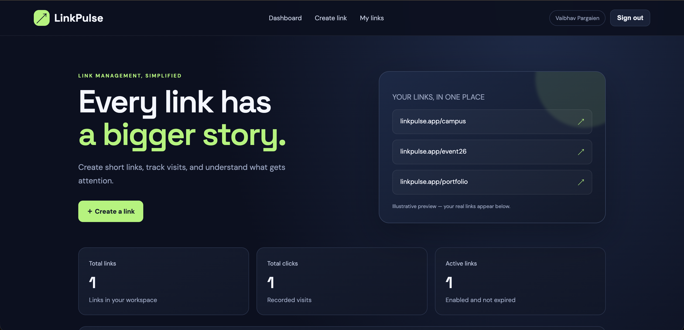
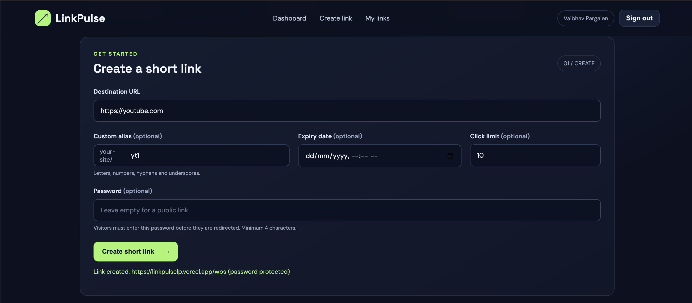
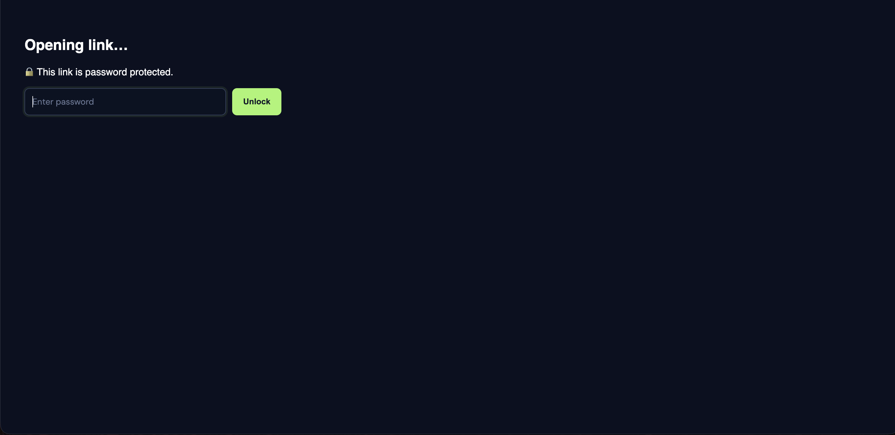

# LinkPulse

A link shortener with analytics, built for a hackathon with HTML, CSS, JavaScript and Firebase.

**Live link:** https://linkpulselp.vercel.app
**Team:** levelsabkeniklenge

## Problem statement

Long URLs are hard to share, impossible to remember, and give no insight into who actually opens them. Most free link shorteners also give no control over who can use a link or for how long, so links stay open to everyone forever.

## Solution

LinkPulse lets users create short links they fully control: custom aliases, expiry dates, click limits and password protection, plus a dashboard that shows how many times each link was opened. It runs on Firebase (Authentication and Firestore), so it needs no custom server.

## Features

- Sign in with Google
- Create short links with a random code or a custom alias
- Optional **expiry date**, **click limit** and **password protection**
- Short links look like `linkpulselp.vercel.app/abc123` and redirect instantly
- Dashboard with total links, total clicks and active links
- Click tracking, with each visit stored as a click event
- Disable a link at any time

## Tech stack

| Part | Tool |
|------|------|
| Frontend | HTML, CSS, vanilla JavaScript (ES modules) |
| Build tool | Vite |
| Authentication | Firebase Authentication (Google) |
| Database | Cloud Firestore |
| Hosting | Vercel |

## Screenshots





## How it works

1. The user signs in with Google and fills in the form (destination URL, optional alias, expiry, click limit, password).
2. The app validates the input, checks that the alias is free, and saves the link in Firestore.
3. When someone opens `linkpulselp.vercel.app/abc123`, the app looks up the code, checks that the link is active (not disabled, not expired, under its click limit), records the click in a transaction, and redirects to the destination.
4. For password-protected links, the visitor must enter the password before being redirected.

## Database design

| Collection | Purpose | Key fields |
|------------|---------|-----------|
| `links` | One document per short link | `code`, `ownerId`, `status`, `clicks`, `clickLimit`, `expiresAt`, `createdAt`, `destination` (public links only), `protected`, `salt` |
| `linkSecrets` | Destinations of password-protected links | document ID = `linkId_hash`; fields: `destination`, `ownerId` |
| `clickEvents` | One document per visit | `linkId`, `code`, `clickedAt`, `referrer`, `userAgent` |

### Password protection

- The password is never stored. Only a salted PBKDF2 hash is used.
- The destination of a protected link is kept in `linkSecrets`, under a document ID that includes the password hash.
- Security rules block listing that collection, so the destination can only be fetched by someone who knows the password.

### Security rules (summary)

- Anyone can read links (needed for redirects).
- Only signed-in users can create links, and only as themselves.
- Only the owner can edit a link.
- Everyone else can only increase `clicks` by exactly 1.
- Click events can be created by anyone and read by no one.

The full rules are in `firestore.rules`.

## Setup instructions

1. Clone the repo and install dependencies:
```
   git clone https://github.com/Vaibhav-1048/levelsabkeniklenge-linkpulse.git
   cd levelsabkeniklenge-linkpulse
   npm install
```
2. In the Firebase Console, create a project, register a Web App, and paste its config into `firebase.js`.
3. Enable **Authentication > Sign-in method > Google**.
4. Create a **Firestore Database** and publish the contents of `firestore.rules` under **Firestore > Rules**.
5. Under **Authentication > Settings > Authorized domains**, make sure `localhost` is listed.
6. Start the dev server:
```
   npm run dev
```
   Open the local URL shown in the terminal (usually http://localhost:5173).

## Deployment

The app is deployed on Vercel:

```
npm run build
npx vercel --prod
```

After deploying, add the Vercel domain (without `https://`) to Firebase **Authentication > Settings > Authorized domains**. The `vercel.json` file rewrites all paths to `index.html`, so short links like `/abc123` work.

## Project structure

```
index.html       Page layout
style.css        Styling
main.js          App logic (create links, dashboard, redirects, passwords)
firebase.js      Firebase setup and Google sign-in
firestore.rules  Database security rules
vercel.json      Routing for short links on Vercel
package.json     Dependencies and scripts
```

## Limitations

This is a hackathon prototype. Redirects, click counting and password checks run in the browser, so a determined user could tamper with their own requests or fabricate click data, and password guesses are not rate limited. For production, these would move to a trusted backend such as Firebase Cloud Functions, with alias uniqueness enforced on the server.

## Team members

- Vaibhav Pargaien ([@Vaibhav-1048](https://github.com/Vaibhav-1048))
